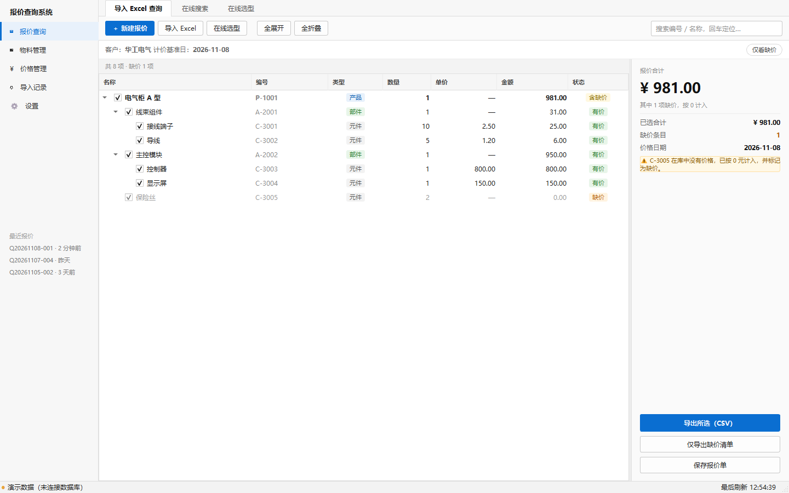

# 报价查询系统

电气公司零部件报价查询工具。按 [软件功能设计](softwareDesign/软件功能设计.md) 实现，Qt 6 Widgets + MySQL。



---

## 仓库结构

```
PriceQuerySoftware/
├── software/                 ← Qt 工程（在这里构建）
│   ├── CMakeLists.txt
│   ├── CMakePresets.json     ← 一键配置：MinGW 13.1 + Qt 6.10.0
│   ├── src/                  ← 源码 + src/forms/*.ui
│   ├── db/                   ← 建库脚本 01~04
│   └── build/                ← 生成物（已 gitignore）
└── softwareDesign/           ← 设计文档与原型
    ├── 软件功能设计.md
    ├── 数据库设计.md / 数据库设计详解.md
    ├── 界面设计.md
    ├── ui/mockups/           ← HTML 高保真稿
    └── ui/screenshots/       ← 实际运行截图
```

---

## 快速开始

### 命令行（推荐）

```powershell
cd software
cmake --preset mingw-release
cmake --build --preset release
.\build\bin\PriceQuerySoftware.exe --demo
```

预设里已经写死了本机的 Qt 路径和 MinGW 编译器，不需要再配 `CMAKE_PREFIX_PATH`。
换机器的话改 `software/CMakePresets.json` 里那三个 `D:/QtCreate/...` 路径即可。

### VS Code

直接用 VS Code 打开 `software/` 目录（**不是仓库根目录**），CMake Tools 会自动读到
`CMakePresets.json`，选 `mingw-release` 就能构建和调试。`.vscode/` 里已配好
cmake 路径、C++17 标准和 compile_commands。

### 手动 cmake（不想用预设）

```powershell
cmake -S software -B software/build -G Ninja -DCMAKE_BUILD_TYPE=Release `
  -DCMAKE_PREFIX_PATH="D:/QtCreate/6.10.0/mingw_64" `
  -DCMAKE_CXX_COMPILER="D:/QtCreate/Tools/mingw1310_64/bin/g++.exe"
cmake --build software/build
```

### 打包运行库

```powershell
D:\QtCreate\6.10.0\mingw_64\bin\windeployqt.exe --release software\build\bin\PriceQuerySoftware.exe
```

做过之后 `build/bin` 自带 Qt DLL，不配 PATH 也能双击运行。

---

## 数据库

```powershell
mysql -u root -p --default-character-set=utf8mb4 < software/db/01_schema.sql
mysql -u root -p --default-character-set=utf8mb4 < software/db/02_logic.sql
mysql -u root -p --default-character-set=utf8mb4 < software/db/03_sample_data.sql
```

连不上库时程序会自动降级为演示数据，界面照样能跑。三种连接方式：

1. 程序内「设置」页填参数后点「测试并应用」（存注册表 `HKCU\Software\PriceQuery\PriceQuerySoftware`）
2. 命令行：`--host 127.0.0.1 --port 3306 --user root --password 你的密码 --dbname price_query`
3. 演示模式：`--demo`

> **注意驱动**：这套 Qt 没带 `qsqlmysql.dll`（官方安装器不再预编译官方 MySQL 插件）。
> 程序按 `QMYSQL → QODBC → 演示数据` 三级降级，本机走的是 MySQL ODBC 9.5 驱动，
> 状态栏会显示当前用的是哪一个。详见 [README 的驱动说明](software/README.md)。

---

## 界面：全部在 `software/src/forms/*.ui`

10 个 `.ui` 覆盖所有界面，`cpp` 里只有 `setupUi` + model/delegate + 信号槽：

| `.ui` | 页面 |
|---|---|
| `mainwindow.ui` | 外壳（导航 + 页面容器 + 状态栏） |
| `quotationpage.ui` | 报价查询 |
| `materialpage.ui` | 物料管理 |
| `pricepage.ui` / `importpage.ui` / `settingspage.ui` | 价格 / 导入记录 / 设置 |
| `wizard*.ui` × 4 | 导入向导的 4 步内容 |

用 Designer 打开：

```powershell
D:\QtCreate\6.10.0\mingw_64\bin\designer.exe software\src\forms\quotationpage.ui
```

样式靠 `.ui` 里的**动态属性 `kind`**（`primary`、`muted`、`h1`…）配 QSS 属性选择器，
不是 objectName——所以 Designer 里改控件名不会丢样式。

---

## 文档

| 文档 | 内容 |
|---|---|
| [软件功能设计](softwareDesign/软件功能设计.md) | 原始需求 |
| [数据库设计](softwareDesign/数据库设计.md) | 表结构、建模取舍、ER 图 |
| [数据库设计详解](softwareDesign/数据库设计详解.md) | 逐表逐字段讲解 + SQL 语法 |
| [界面设计](softwareDesign/界面设计.md) | 布局、交互、视觉规范、Qt 实现映射 |
| [软件开发说明](software/README.md) | 工程细节、踩坑记录、开发参数 |

---

## 当前完成度

| 模块 | 状态 |
|---|---|
| 报价查询树、缺价标识、三态复选、搜索、CSV 导出 | ✅ 可用 |
| 物料管理、价格管理、导入记录（读库） | ✅ 可用 |
| 导入向导 | ⚠️ 界面完整，预检数据写死 |
| 新建/编辑/删除物料、保存报价单 | ⚠️ 只有入口 |
| Excel 解析（QXlsx）、写库、事务 | ❌ 未实现 |
