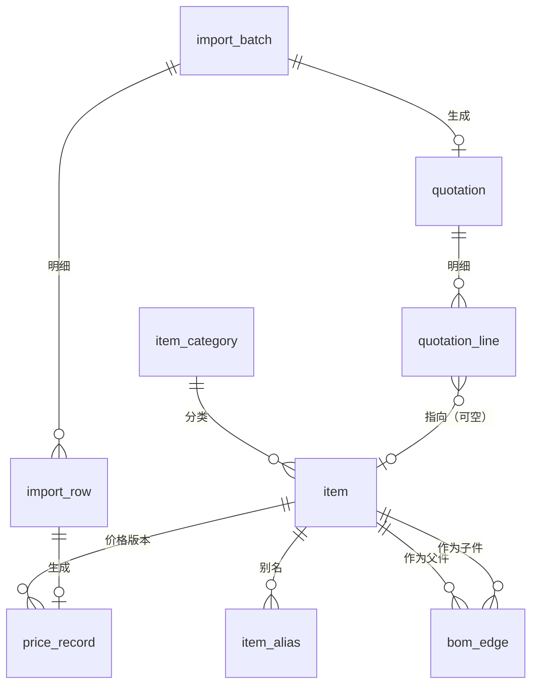

# 报价查询系统 · 数据库设计

> 对应需求：[软件功能设计.md](软件功能设计.md)
> 技术选型：MySQL 8.0.16+ / InnoDB / utf8mb4，客户端 Qt 6 + C++17
> 配套脚本：[db/01_schema.sql](../software/db/01_schema.sql)、[db/02_logic.sql](../software/db/02_logic.sql)、[db/03_sample_data.sql](../software/db/03_sample_data.sql)

---

## 0. 结论先行

整个系统的数据其实只有三类：**物料（是什么）**、**包含关系（由什么组成）**、**价格（值多少钱）**。其余都是围绕它们的批次、快照和审计。

核心 5 组表（共 7 张）：

| 表 | 作用 | 一句话 |
|---|---|---|
| `item` | 物料主表 | 元件/部件/产品同表，`item_type` 区分 |
| `bom_edge` | 包含关系 | `(父件, 子件) → 用量`，邻接表 |
| `price_record` | 价格 | 版本化；元件存单价，部件/产品只存“历史成交总价”用于校验 |
| `import_batch` / `import_row` | 导入 | 批次 + 明细，原始行落库 |
| `quotation` / `quotation_line` | 报价单 | 结果快照，价格冻结 |

一句话原则：**只有元件有“可录入的价格”，部件和产品的价格永远是算出来的，不存、不改、不信任。**

---

## 1. 三个关键设计决策

### 1.1 元件 / 部件 / 产品：一张表 + 类型字段

看起来应该建三张表，实际上不行。因为：

- 报价查询要在一个结果列表里同时展示三种对象，三张表就得 `UNION ALL`，还要处处 `CASE`；
- BOM 边表的父/子两侧都要能指向任意类型，三张表意味着边表要 3×3 组外键或加 `parent_type/child_type` 判别列——这正是“多态外键”泥潭；
- 价格、别名、导入匹配、审计，逻辑完全一致，却要为每张表复制一份。

三者的字段也确实完全一样（编号、名称、规格、单位、分类、备注），差异只在**行为**：

| 类型 | 能否有子件 | 价格从哪来 |
|---|---|---|
| `component` 元件 | 否 | 人工录入 / Excel 导入（唯一的价格输入源） |
| `assembly` 部件 | 是 | 子件价格汇总 |
| `product` 产品 | 是 | 子件价格汇总，且不能作为别人的子件 |

所以：**单表继承**（`item` + `item_type` ENUM），差异用约束表达——触发器拦住“元件有子件”“产品当子件”。

> 如果将来三种类型真的长出差异字段（比如产品要交期、元件要供应商），再加 `item_product_ext` / `item_component_ext` 扩展表，主表不动。这是可演进的写法。

### 1.2 包含关系：邻接表 + 用量挂在边上

```sql
bom_edge(parent_id, child_id, quantity, seq_no)
```

三个要点：

1. **用量属于“边”而不属于“件”**。同一个 `C-3001 接线端子`，装在 `线束 A-2001` 里用 10 个，装在别处可能用 2 个。把 `quantity` 放在 `item` 上是这类系统最常见的建模错误。
2. **不建闭包表（closure table）**。闭包表适合深树和高频子树查询，但本系统层级固定为 产品→部件→元件（最多再加一层子部件），递归 CTE 一条语句就能展开，多维护一张表的收益为负。等哪天层级变深、查询变慢，再加闭包表只是增量改造。
3. **必须防环**。`A 含 B`、`B 含 A` 会让报价计算无限递归，也会让 `tree` 展示崩溃。用触发器拦基本错误，用 `sp_bom_add_edge` 做递归环检测。

层级关系在**查询时**展开，不在数据库里冗余存储路径——因为同一个元件可以出现在多个产品下，"路径"不是物料的属性，而是某一次遍历的结果。

### 1.3 价格：把“输入价”和“推导价”彻底分开

这是需求里最危险的地方：文档说部件/产品价格“由所有部件、元件价格加和”，又说导入的 Excel 里带着部件和产品的价格，两者对不上要报错。翻译成数据模型就是：

- **元件单价 = 输入（input）**，是计算的唯一依据；
- **部件/产品总价 = 输出（output）**，任何时刻都必须能由元件价重新算出来；
- Excel 里给的部件/产品价格是**历史成交价**，它是对“输出”的一次观测值，用来校验，而不是用来参与计算。

于是 `price_record.price_kind` 只有两个值：

| `price_kind` | 载体 | 含义 | 是否参与计算 |
|---|---|---|---|
| `direct` | 元件 | 录入/导入的单价 | ✅ 唯一输入 |
| `reported` | 部件/产品 | Excel 中的成交总价 | ❌ 仅校验与追溯 |

配套的几条规则：

- **价格带日期版本化**（`price_date`）。查询时取“基准日之前最新的一条”，所以今天导入 2023 年的历史成交价，不会污染当前报价。
- **缺价不是 0**。库里没有价格就是 `NULL`，展示层显示 0 并标灰；如果直接存 0，就再也分不清“免费”和“没录价”了。
- **部件/产品不设可编辑价格列**。这是需求“部件、产品的价格不支持修改”的结构性保证——不是靠界面禁用输入框，而是数据库里根本没有这个字段。
- **报价单存快照**。报价一旦生成，`quotation_line` 里的单价金额就冻结，之后改元件价不会改写历史报价。

---

## 2. ER 图



可空的那条线很重要：`quotation_line.item_id` 允许为 `NULL`，表示“Excel 里出现了、但数据库里没有”的物料。需求要求这类数据也要展示、标灰、能导出，所以它必须是合法数据，而不是被拒绝的行。

---

## 3. 表结构说明

### 3.1 `item` 物料主表

| 字段 | 类型 | 说明 |
|---|---|---|
| `id` | BIGINT UNSIGNED PK | 内部主键，所有关联都用它 |
| `item_code` | VARCHAR(64) UNIQUE | 编号，全局唯一（三类共用一个命名空间，避免同号异构） |
| `item_name` | VARCHAR(255) | 名称 |
| `item_type` | ENUM | component / assembly / product |
| `spec` `unit` `category_id` `remark` | | 规格、单位、分类、备注 |
| `status` | TINYINT | 1 启用 / 0 停用 / -1 软删除 |

- 排序规则 `utf8mb4_0900_ai_ci` 大小写不敏感，`abc-01` 和 `ABC-01` 视为同一个编号，符合实际使用习惯。
- 软删除而非物理删除：历史报价单里可能引用它，删了快照就断层。
- 全文索引 `ft_item_name_spec (item_name, spec) WITH PARSER ngram` 用于中文模糊匹配。

### 3.2 `bom_edge` 包含关系

| 字段 | 说明 |
|---|---|
| `parent_id` + `child_id` | 联合主键，天然去重（同一子件在一个父件下只出现一次） |
| `quantity` | DECIMAL(18,4)，CHECK > 0 |
| `seq_no` | 同级展示顺序，保证树展开顺序稳定 |
| `unit` | 可选，用量单位和子件单位不一致时用 |

外键策略刻意不对称：父件删除级联删边（`ON DELETE CASCADE`），子件删除则受限（`ON DELETE RESTRICT`）——从主数据层面就阻止“删掉元件导致别的产品 BOM 断裂”。

### 3.3 `price_record` 价格

| 字段 | 说明 |
|---|---|
| `price_kind` | direct / reported，见 1.3 |
| `amount` | DECIMAL(18,4)。direct 是单价，reported 是总价 |
| `price_date` | 生效日 / 成交日 |
| `source` | manual / excel / system |
| `import_row_id` | 溯源到具体 Excel 行 |
| `created_by` | 操作人，便于追责 |

唯一键 `(item_id, price_kind, price_date)`：同一天同一物料同一类价格只保留一条，重复导入即覆盖（`ON DUPLICATE KEY UPDATE`），这正是“重新导入修正错误数据”的期望行为。

> 如果业务上存在“同一元件一天内多次成交、价格不同”，把唯一键去掉、改为普通索引，并在查询时用 `price_date DESC, id DESC` 取最新即可。这个改动只影响一个视图。

视图 `v_item_direct_price` 封装“当前有效价”，所有查询只跟视图打交道，将来换取价策略不用改业务代码。

### 3.4 `import_batch` / `import_row` 导入

需求里两张 Excel 模板都“待定”，所以这一层的设计目标就是**抗变更**：

- `raw_json` 保存整行原始单元格，模板改了也不丢数据，还能重放导入；
- `row_no` 保存 Excel 行号，报错能直接告诉用户“第 37 行”；
- `file_sha256` 防重复导入；
- `computed_amount` 保存系统算出的值，与 `amount`（Excel 给的值）并列，**差异一目了然，且能直接导出成“对不上账”清单**。

### 3.5 `quotation` / `quotation_line` 报价单

- `source` 记录来源：导入 Excel 查询 / 在线搜索 / 在线选型；
- `price_date` 是计价基准日，`NULL` 表示用当前最新价；
- `price_state` 四态：`priced` 有价、`missing` 无价、`zero` 价格为 0、`manual` 手工改价——正好支撑“灰色显示”和“单独导出无价清单”两个需求；
- `sort_key`（如 `001.002.003`）是字符串排序键，一次 `ORDER BY` 就能还原整棵树，不用递归；
- `line_source` 区分“用户给的行”和“BOM 展开的行”，导出时可以只导原始行或全部展开行。

### 3.6 辅助表

| 表 | 用途 |
|---|---|
| `item_alias` | 客户料号/旧 ERP 编号映射，Excel 匹配成功率的关键 |
| `item_category` | 分类树，可选 |
| `audit_log` | 改价、改 BOM、导入、导出留痕（单机版也建议保留，出问题能回查） |
| `app_setting` | 键值配置：模板版本、缺价容差、计价策略 |
| `schema_version` | 程序启动时校验库结构版本，防止旧库配新程序 |

---

## 4. 关键流程的 SQL

### 4.1 展开 BOM（一次查询取回整棵树）

```sql
WITH RECURSIVE sub AS (
    SELECT i.id, i.item_code, i.item_name, i.item_type,
           CAST(NULL AS UNSIGNED)        AS parent_id,
           CAST(1 AS DECIMAL(18,4))      AS quantity,
           0                             AS depth,
           CAST('001' AS CHAR(255))      AS sort_key
    FROM item i
    WHERE i.id = 1                        -- 根：产品 id

    UNION ALL

    SELECT c.id, c.item_code, c.item_name, c.item_type,
           e.parent_id, e.quantity, s.depth + 1,
           CONCAT(s.sort_key, '.', LPAD(e.seq_no, 3, '0'))
    FROM sub s
    JOIN bom_edge e ON e.parent_id = s.id
    JOIN item c     ON c.id = e.child_id
    WHERE s.depth < 20                    -- 兜底：环或脏数据时不会无限递归
)
SELECT s.*, p.amount AS unit_price
FROM sub s
LEFT JOIN v_item_direct_price p ON p.item_id = s.id   -- 无价 → NULL
ORDER BY s.sort_key;
```

`parent_id` + `depth` + `sort_key` 三个字段足以在 C++ 端一次性构建 `QAbstractItemModel` 的树，不需要按层发 N 次查询。

### 4.2 自底向上汇总金额

推荐在 C++ 端做，而不是数据库端：

```
后序遍历（DFS）：
    叶子（元件）：total = quantity × unit_price   （无价时 unit_price = 0，并标记 missing）
    内部节点：    total = Σ(子节点 total)
```

理由：树已经在内存里了，O(n) 一次遍历即可；若放到 SQL，得用“路径前缀 LIKE 自连接”做，复杂度反而更高。

需要数据库端校验时可用：

```sql
-- 每个节点的金额 = 其子树所有叶子金额之和
WITH RECURSIVE sub AS (
    SELECT id, CAST('' AS CHAR(4000)) AS path, CAST(1 AS DECIMAL(28,8)) AS qty, 0 AS depth
    FROM item WHERE id = 1
    UNION ALL
    SELECT e.child_id, CONCAT(s.path, '/', e.child_id), s.qty * e.quantity, s.depth + 1
    FROM sub s JOIN bom_edge e ON e.parent_id = s.id
    WHERE s.depth < 20
),
leaf AS (
    SELECT s.id AS node_id, s.path, s.qty * IFNULL(p.amount, 0) AS amount
    FROM sub s
    LEFT JOIN v_item_direct_price p ON p.item_id = s.id
    WHERE NOT EXISTS (SELECT 1 FROM bom_edge e WHERE e.parent_id = s.id)
)
SELECT n.id, n.depth, SUM(l.amount) AS total
FROM sub n
JOIN leaf l ON l.path LIKE CONCAT(n.path, '/%')
GROUP BY n.id, n.depth;
```

### 4.3 缺价检测（导出“待询价清单”）

```sql
SELECT i.id, i.item_code, i.item_name, i.item_type, i.unit
FROM item i
LEFT JOIN v_item_direct_price p ON p.item_id = i.id
WHERE i.status = 1
  AND p.item_id IS NULL
  AND i.item_type = 'component'          -- 只有元件需要价格
ORDER BY i.item_code;
```

### 4.4 模糊搜索

```sql
-- 中文名称：nGram 全文索引（ngram_token_size 默认 2，即按二字词切分）
SELECT * FROM item
WHERE MATCH(item_name, spec) AGAINST ('端子' IN BOOLEAN MODE)
  AND status = 1
LIMIT 200;

-- 编号：前缀匹配走 uk_item_code 索引
SELECT * FROM item WHERE item_code LIKE 'C-30%' AND status = 1 LIMIT 200;
```

> 注意：`LIKE '%关键字%'` 用不到索引，几万行内尚可接受；`MATCH` 请直接查 `item` 表，不要查视图。

### 4.5 改价后，哪些产品受影响（向上追溯）

```sql
WITH RECURSIVE up AS (
    SELECT parent_id, 1 AS lvl FROM bom_edge WHERE child_id = 4   -- 改价的元件
    UNION ALL
    SELECT e.parent_id, u.lvl + 1
    FROM bom_edge e JOIN up u ON e.child_id = u.parent_id
    WHERE u.lvl < 20
)
SELECT DISTINCT parent_id FROM up;
```

用于提示用户“该元件涨价会影响 12 个部件和 3 个产品”，也用于将来做价格缓存失效。

### 4.6 历史价格导入的一致性校验

对每一行 `reported` 价格（部件/产品）：

```
系统值 = 展开该物料子树，按 4.2 后序汇总
若 |系统值 − Excel值| > 容差(0.01)  → 该行 row_status='error'，message 记录两个值
若子树中存在缺价元件            → 该行 row_status='warn'，说明“无法校验，有 N 个缺价元件”
```

结果写回 `import_row.computed_amount` 和 `message`，界面直接列表展示，也能一键导出“对不上账”的行。

---

## 5. 一致性与事务

| 场景 | 事务边界 | 说明 |
|---|---|---|
| 历史价格导入 | 整个批次一个事务 | 需求要求“对不上就报错”，要么全成功要么全不写入，避免半套数据 |
| 报价查询导入 | 批次一个事务 + 报价单一个事务 | 解析、匹配、快照写入原子完成 |
| 修改 BOM | 删旧边 + 插新边 + 重算 + 审计，一个事务 | 中途失败不能留下“半个 BOM” |
| 改元件价格 | UPSERT 价格 + 审计，一个事务 | 不需要重算，价格是推导的 |

几条实现约定：

1. Qt 侧统一用 `QSqlDatabase::transaction()` / `commit()` / `rollback()`，封装 RAII，异常或早退自动回滚。
2. `sp_bom_add_edge` **内部不开事务**，由调用方控制，这样才能把“改 BOM + 写审计”放进同一个事务。
3. 大文件导入按 500~1000 行 `COMMIT` 一次，并把 `import_batch.status` 置为 `running`，崩溃后能看出哪批没跑完。
4. 单价用 `DECIMAL`，**任何环节都不要用 `double`**（见 7.4）。

---

## 6. 索引与性能

| 查询 | 走的索引 |
|---|---|
| 按编号精确查 | `uk_item_code` |
| 展开 BOM 的每一层 | `PK(parent_id, child_id)`、`idx_edge_child` |
| 取当前价 | `uk_price_item_kind_date` |
| 名称模糊搜索 | `ft_item_name_spec`（全文）/ `idx_item_name`（前缀） |
| 报价单展示 | `idx_line_quote (quotation_id, sort_key)` |
| 按类型筛选列表 | `idx_item_type_status` |

数据量预估与结论：即便 5 万个元件、2000 个产品、每个产品 200 个零件，展开一个产品也只需毫秒级。**不需要缓存表**。若将来产品数上万且要频繁列表页展示总价，再加 `item_price_cache(item_id, total_price, computed_at, dirty)`，配合 4.5 的向上追溯做失效即可——这是增量改造，不影响现有结构。

---

## 7. Qt / C++ 侧设计

### 7.1 依赖与部署

| 组件 | 说明 |
|---|---|
| Qt 6.5 LTS（C++17） | Widgets + Sql |
| `QMYSQL` 驱动 | Qt 自带插件，但需随包部署 `libmysql.dll`（MySQL 8 客户端库）及其依赖 `libssl-3-x64.dll`、`libcrypto-3-x64.dll` |
| QXlsx | 读写 xlsx，不依赖本机安装 Office |
| CMake | 构建 |

> 部署坑：`QMYSQL driver not loaded` 十有八九是 `libmysql.dll` 位数不对（必须与 exe 同为 x64）或缺 OpenSSL DLL。建议在“关于”窗口里打印 `QSqlDatabase::drivers()`，出问题一眼定位。

### 7.2 分层

```
ui/            MainWindow、BomTreeView、ImportWizard、PriceEditor
model/         BomTreeModel(QAbstractItemModel)、QuotationTableModel
service/       PriceCalculator、ImportService、QuotationService、BomService
repository/    ItemRepo、BomRepo、PriceRepo、QuotationRepo、ImportRepo
db/            DbManager（连接）、Transaction（RAII）、Money（定点金额）
domain/        Item、PriceRecord、BomNode、QuotationLine（纯结构体，不含 SQL）
```

`service` 只依赖 `repository` 接口，SQL 全部集中在 `repository`。好处：将来若要换 SQLite（便携版分发）或换 MySQL 协议库，只改一层。

### 7.3 连接管理

```cpp
QSqlDatabase db = QSqlDatabase::addDatabase("QMYSQL", "main");
db.setHostName(cfg.host);
db.setPort(cfg.port);
db.setDatabaseName(cfg.database);
db.setUserName(cfg.user);
db.setPassword(cfg.password);
db.setConnectOptions("MYSQL_OPT_CONNECT_TIMEOUT=5;MYSQL_OPT_RECONNECT=1");
if (!db.open()) { /* 提示：服务未启动 / 密码错 / 端口被占 */ }
```

- 单机单用户：一个主连接足够；导入放到后台线程时，**每个线程必须用自己的连接**（`QSqlDatabase` 不可跨线程共享）。
- 启动时先 `SELECT version FROM schema_version` 校验版本，不匹配则拒绝启动并提示升级。

### 7.4 金额与日期

`DECIMAL(18,4)` ↔ 定点整数，绝不用 `double`：

```cpp
struct Money { qint64 v = 0; };   // 放大 10000 倍，v=25000 即 2.5000
```

- 读写：`QString::toLongLong` / `QString::number(v)`，或直接 `CAST(amount*10000 AS SIGNED)`。
- 只在显示时格式化，`QString::asprintf("%.2f", v/10000.0)`。
- 日期统一 `QDate::toString(Qt::ISODate)`，SQL 里用 `DATE`，不要用 `DATETIME` 存“价格日期”。

### 7.5 树形展示与灰色缺价

`BomTreeModel : QAbstractItemModel`，列：名称 / 编号 / 数量 / 单价 / 金额 / 状态。

- 缺价行：`data(..., Qt::ForegroundRole)` 返回 `QColor(150,150,150)`，同时金额显示 0；
- 支持三态复选：父节点 `Qt::Checked`/`PartiallyChecked`，用于“选中部分零部件单独计价”和“导出所选”；
- 汇总列由 4.2 的后序遍历算好后缓存到节点，避免 `data()` 里重复计算；
- 大数据量用 `canFetchMore` / `fetchMore` 惰性加载子节点。

### 7.6 Excel 导入导出

- **读取**：QXlsx 只把单元格读成 `QVariant`，映射到 `import_row.raw_json`，再走统一校验管线——不要一边读一边写库。
- **写入**：导出使用同一个模板渲染器，保证“导出的表能原样再导入”。
- **后台线程**：解析 Excel 放在 `QThread`，进度条按行回调；数据库写入回到主线程或独立连接。

### 7.7 配置与密码

`QSettings` 存连接参数；密码用 Windows DPAPI（`CryptProtectData`）加密后存储，不要明文写 ini。

---

## 8. 版本演进

| 阶段 | 内容 |
|---|---|
| v1 | 01_schema.sql 全量建库 |
| 后续 | 每次结构变更新增 `04_migration_v2.sql`，并在 `schema_version` 插入一条记录 |
| 程序启动 | 读 `schema_version` 最大值，低于程序要求则提示“数据库需要升级”，并自动按顺序执行迁移脚本 |

模板变更（两张 Excel 模板都“待定”）不涉及表结构：`import_batch.template_version` + `raw_json` 已经能容纳任意列，新增列只需改代码里的映射表。

---

## 9. 待确认的问题

以下几条会实质影响表结构，建议在开发前定下来：

1. **单机还是局域网多人共用？**

   单机开发。

   单机 → 现有设计足够，`operator` 取 Windows 账号即可；
   多人 → 需要加 `app_user` 表、行级权限、乐观锁（`item.version`），并考虑报价单号并发生成。

2. **报价是否需要“按历史某一天的价”出？**
   
   现设计已支持（`price_date` 基准日 + `quotation.price_date`）。若不需要，可以简化掉 `quotation.price_date`。
   
3. **是否需要不含税/含税、多币种、折扣？**
   现在 `currency` 已预留，但税率、折扣未建模。若报价单要出税额，需在 `quotation` 加 `tax_rate`、`tax_amount`，`price_record` 加 `price_includes_tax`。
   
4. **一张 Excel 里的层级怎么表达？**
   
   Excel中不需要考虑层级关系，具体输出格式待定。
   
   缩进列？层级编号列（1.2.3）？还是只给产品编号、其余全靠 BOM 展开？
   这决定 `import_row` 是否需要 `level` / `parent_row_no` 字段，以及报价查询能否复用 BOM 展开。
   
5. **元件编号是否允许一物多码？
   
   元件编号唯一，全局不允许重复。
   
   已用 `item_alias` 预留，需要确认“一个编号能否对应多个物料”（现在是一对多，反过来的多对多要改成中间表）。
   
6. **是否需要供应商、交期、最小起订量？**
   报价场景常见，但当前需求未提。若要，加 `supplier` / `item_supplier` 表即可，不影响主结构。

---

## 附：需求覆盖对照

| 需求 | 实现方式 |
|---|---|
| 历史价格导入（含总价校验） | `import_batch` / `import_row` + `price_record(reported)` + 4.6 校验 |
| 元件价格修改 | `price_record(direct)` UPSERT；界面只对 `item_type='component'` 开放编辑 |
| 部件/产品价格不可修改 | 结构性保证：库里没有这个可写字段，价格永远由 4.2 汇总 |
| 零部件增删改 | `item.status` 软删除 + `sp_item_delete` 引用检查 |
| 产品部件关系修改 | `bom_edge` 整体替换（事务内先删后插）+ `sp_bom_add_edge` 环检测 |
| Excel 报价查询 | 导入 → 匹配（编号/别名）→ 展开 → 汇总 → `quotation_line` 快照 |
| 在线模糊搜索 | 4.4：nGram 全文 + 编号前缀 |
| 在线选型查询 | 下拉逐级选 `bom_edge`，同一套展开与汇总逻辑 |
| 分级展示 / 展开合并 | `sort_key` + `depth` + `parent_id`，`QAbstractItemModel` 树 |
| 缺价灰色显示 | `quotation_line.price_state='missing'` → `Qt::ForegroundRole` |
| 选中部分单独计价 | 行级 `selected` 标记，汇总时只算选中节点 |
| 导出 Excel | 按 `sort_key` 排序导出，可按 `price_state` / `selected` 过滤 |
