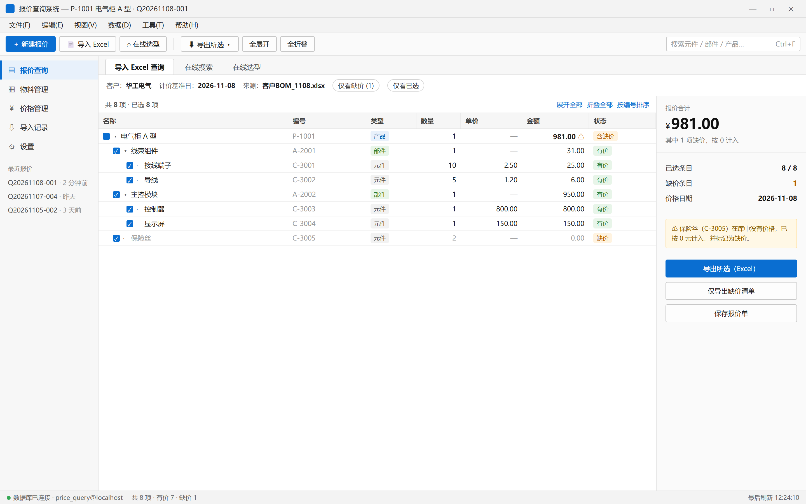
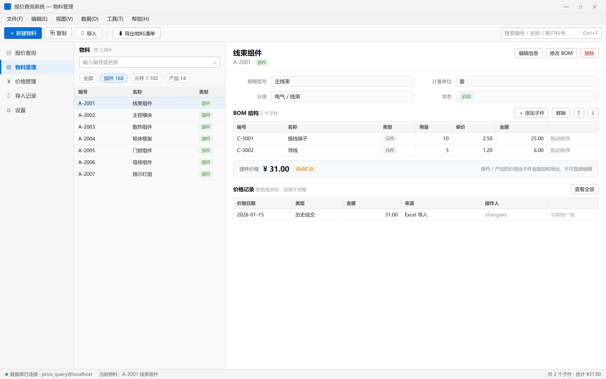
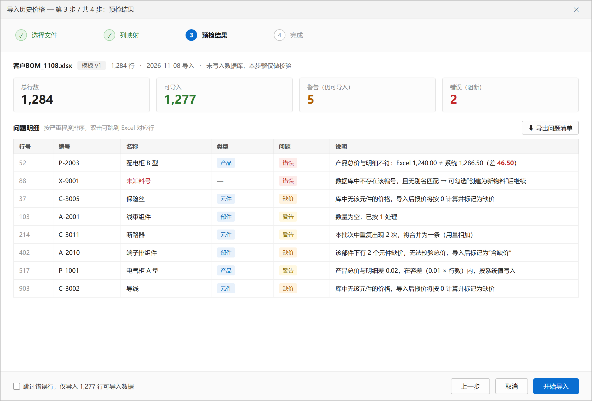

# 界面设计

> 对应需求：[软件功能设计.md](软件功能设计.md)　数据基础：[数据库设计.md](数据库设计.md)
> 可视化稿：[ui/mockups/](ui/mockups/)（HTML + PNG，可改可重渲染）
> 技术栈：Qt 6 Widgets / C++17 / Windows 桌面

---

## 1. 设计定位

**这是一件工具，不是一个网站。** 用户是每天要出十几份报价的工程师，衡量标准只有两条：**一眼看清、少点几下**。

由此定下五条原则：

| 原则 | 具体做法 | 反面教材 |
|---|---|---|
| 任务导向，不是数据表导向 | 导航按"我要干什么"分（查报价、管物料），不按数据库表分 | 一级菜单叫"item 表""bom_edge 表" |
| 信息密度优先 | 12px 字号、26px 行高，一屏放 25~30 行 | 卡片留白、大图标、每行 60px |
| 缺价是一等公民 | 缺价不是"算不出来"，而是**必须被看见、被导出、被跟进**的状态 | 缺价静默按 0，合计看起来正常 |
| 危险操作才弹确认 | 删除、覆盖导入弹；展开、筛选、导出不弹 | 每次导出都问"确定吗" |
| 能撤销就不确认 | 改 BOM 先在内存改，点"保存"才落库 | 每勾一个复选框就写数据库 |

**不做的事**：不做仪表盘首页、不做主题切换、不做响应式。单机 Windows 工具，屏幕尺寸可预期（≥1366×768）。

---

## 2. 信息架构

```
报价查询  ← 默认页，打开即用
├── 导入 Excel 查询
├── 在线搜索
└── 在线选型
物料管理
├── 物料列表（元件/部件/产品）
└── 详情 + BOM 结构
价格管理
├── 元件价格（当前价 + 历史）
└── 历史成交价对账
导入记录
└── 批次列表 → 明细 / 错误行
设置
├── 数据库连接
├── Excel 模板映射
└── 计价策略（基准日、容差、取价规则）
```

**为什么没有首页**：用户 80% 的时间在"查报价"。启动直接进报价查询，省一次点击；"最近报价"放在左侧栏底部，等于一个轻量首页。

**为什么"物料管理"和"价格管理"分开**：改物料结构（BOM）和改价格是两种心智、两种权限、两种出错后果。合并成一个"数据维护"会让用户误以为改价格也会改结构。

---

## 3. 主窗口骨架



```
┌──────────────────────────────────────────────────────────────────────┐
│ 标题栏  报价查询系统 — P-1001 电气柜 A 型 · Q20261108-001      — □ ✕ │
├──────────────────────────────────────────────────────────────────────┤
│ 菜单栏  文件  编辑  视图  数据  工具  帮助                            │
├──────────────────────────────────────────────────────────────────────┤
│ 工具栏  [新建报价][导入 Excel][在线选型] │ [导出所选▾][全展开][全折叠] │  [搜索框]
├──────────┬───────────────────────────────────────────────────────────┤
│ 侧边导航 │  Tab: 导入Excel查询 | 在线搜索 | 在线选型                   │
│ ▸报价查询│  过滤条: 客户 · 基准日 · 来源 · [仅看缺价] [仅看已选]        │
│  物料管理│ ┌──────────────────────────────────────┬────────────────┐ │
│  价格管理│ │ 结果树（QTreeView，7 列，可复选）      │ 汇总面板        │ │
│  导入记录│ │  ▾ 电气柜 A 型     … 981.00 ⚠ 含缺价  │  合计 ¥981.00   │ │
│  设置    │ │    ▾ 线束组件      …  31.00   有价    │  缺价 1         │ │
│          │ │      · 接线端子    …  25.00   有价    │  [导出所选]     │ │
│ 最近报价 │ │      · 保险丝      …   0.00   缺价    │  [导出缺价清单] │ │
│          │ └──────────────────────────────────────┴────────────────┘ │
├──────────┴───────────────────────────────────────────────────────────┤
│ 状态栏  ● 数据库已连接 · price_query@localhost   共8项·缺价1   12:24:10│
└──────────────────────────────────────────────────────────────────────┘
```

**尺寸**：默认 1440×900，最小 1280×800。左侧导航固定 176px，右侧汇总面板固定 268px，中间树自适应。

**为什么用左右分栏而不是上下**：树是纵向长的，汇总面板也是纵向窄的，两者并排能在同一屏内同时看到"明细"和"结论"。上下布局会把树压到只有十几行。

**状态栏必须显示数据库连接状态**。这是单机 + 独立数据库的典型故障点：MySQL 服务没启动、密码改了、端口被占。放在状态栏常驻，比弹窗友好得多——用户一眼就知道"为什么所有数字都是灰的"。

---

## 4. 报价查询（核心页）

### 4.1 三种输入，一个结果区

顶部三个 Tab 不是三个页面，而是同一个结果区的三种"喂数据"方式：

| Tab | 输入方式 | 结果来源 | `quotation.source` |
|---|---|---|---|
| 导入 Excel 查询 | 选文件 → 向导 → 预检 | Excel 里的行 + BOM 展开 | `excel` |
| 在线搜索 | 输入关键字 → 结果表格 → 勾选加入 | 平铺表格，不展开 | `search` |
| 在线选型 | 三级下拉（产品→部件→元件） | 选中即展开 | `selector` |

三者最终都落到同一个 `QTreeView` 上，因为**"展开、计价、灰显、勾选、导出"这五件事完全一样**。做三个结果界面只会让维护成本翻三倍。

### 4.2 结果树的列

| 列 | 宽 | 说明 |
|---|---|---|
| ☑ 名称 | 34% | 层级缩进 + 展开箭头 + 复选 |
| 编号 | 14% | 等宽字体，便于肉眼比对 |
| 类型 | 9% | 产品/部件/元件 三色徽标 |
| 数量 | 8% | 右对齐，相对父件的用量 |
| 单价 | 11% | 部件/产品显示 `—`（它们是汇总值） |
| 金额 | 12% | 右对齐，父节点加粗 |
| 状态 | 12% | 有价 / 缺价 / 含缺价 |

**刻意不做的列**：分类、供应商、备注、创建时间。报价时用户只看"这东西多少钱"，多余列会挤压名称列，导致中文名称被截断——而名称恰恰是判断依据。

**单价列对部件/产品显示 `—` 而不是合计**：这是界面在诚实地表达数据模型——部件没有"单价"这个概念，只有子件汇总。如果这里也显示数字，用户会以为可以改。

### 4.3 缺价的三重视觉信号

缺价是本系统最需要被"看见"的状态，所以给了三重冗余提示（任何一重视觉障碍都能兜住）：

1. **整行灰色文字**（`#a0a0a0`），与正常行的 `#1f1f1f` 形成明显对比；
2. **金额显示 0.00 + 单价显示 `—`**，而不是留空——留空会让人以为是漏填；
3. **状态列橙色徽标「缺价」**，可以按状态列排序，一眼扫出全部缺价行。

**父节点的处理**是设计难点：电气柜合计 981 里含了一个缺价的保险丝，直接显示 981 会让用户以为"这个产品只值 981"。方案是**金额照常显示 + 追加 ⚠ 图标 + 状态标「含缺价」**，鼠标悬停显示"含 1 项缺价，按 0 元计入"。

不做的事：不把父节点金额标灰（那会让人以为整行都不可信），也不显示 `981.00*`（星号需要额外解释）。

### 4.4 复选与"部分计价"

需求要"支持手动选择某些产品、零部件，单独计算所选的价格"。所以每行带复选框，且支持**三态**：

| 状态 | 含义 | 触发方式 |
|---|---|---|
| ☑ 全选 | 该节点及全部子孙被选中 | 点父节点 |
| ▬ 半选 | 部分子孙被选中 | 取消某个子节点后自动回退 |
| ☐ 未选 | 全不选 | 再点一次 |

右侧汇总面板随之切换：**"合计"永远显示全部，"已选合计"显示勾选部分**。两个数字并排，用户不会搞混。

点击父节点的复选框默认**级联到全部子孙**（这是用户 90% 的意图）；按住 `Ctrl` 点击则只选中该节点自身（少量场景）。

### 4.5 右侧汇总面板

| 区域 | 内容 | 为什么在这里 |
|---|---|---|
| 主数字 | 合计 ¥981.00（26px 加粗） | 报价的最终答案，必须是全屏最大字号 |
| 副信息 | 其中 1 项缺价，按 0 计入 | 防止误读合计 |
| 明细行 | 已选 8/8、缺价 1、价格日期 | 一眼核对上下文 |
| 警示条 | ⚠ 具体哪个物料缺价 | 可点击 → 定位到该行 |
| 动作区 | 导出所选 / 仅导出缺价 / 保存报价单 | 看完数字立刻能行动 |

**"仅导出缺价清单"是独立按钮，不是导出对话框里的一个复选框**。因为需求明确："方便客户对没有价格的零部件单独导出进行询价"——这是一个高频的独立任务，藏进二级菜单就废了。

### 4.6 交互清单

| 操作 | 行为 |
|---|---|
| 单击行 | 选中（蓝底），右侧汇总不变 |
| 双击行 | 若为元件 → 打开价格编辑浮层；若为部件/产品 → 跳转到物料详情 |
| 点击展开箭头 / `→` `←` | 展开/折叠单节点 |
| `全展开` / `全折叠` | 工具栏按钮（树很深时也需要） |
| 右键菜单 | 复制编号、复制名称、仅显示该子树、导出该子树、查看价格历史 |
| 拖列头 | 允许用户调列宽，宽度存 `QSettings` |
| 表头排序 | 按编号/金额/状态排序（排序时自动展开全部，否则父子错乱） |
| `Ctrl+A` | 全选（只作用于可见行） |

**排序时的一个坑**：树形结构的排序必须"同级排序、父子不分离"。Qt 的 `QSortFilterProxyModel` 对树的支持有限，建议在自定义 model 里实现 comparator，或在排序时先展开全部再按 `sort_key` 重排。

---

## 5. 物料管理



### 5.1 主从布局

左侧列表（360px）+ 右侧详情。左侧是"找"，右侧是"看和改"。

**为什么不做成"列表 → 弹窗编辑"**：BOM 编辑需要一边看子件、一边改数量，弹窗会挡住上下文。主从布局让"改完立刻看到汇总金额变化"，这是最强的反馈。

### 5.2 详情区的三段

| 段 | 内容 | 交互 |
|---|---|---|
| 头部 | 名称、编号、类型徽标 | 右上角"编辑信息/修改 BOM/删除" |
| 基本信息 | 规格、单位、分类、状态 | 只读展示，点"编辑信息"变可编辑（避免误改） |
| BOM 结构 | 子件表格 + 添加/移除/上移/下移 | 内联改用量，失焦即校验 |
| 汇总条 | **部件价格 ¥31.00 [自动汇总]** | 纯展示，无输入框 |
| 价格记录 | 历史成交价，只读 | "查看全部" |

### 5.3 "部件价格不可编辑"怎么用界面表达

这是整个 UI 里最能体现设计思想的地方。需求说"部件、产品的价格不支持修改"。

**错误做法**：放一个输入框，然后 `setEnabled(false)` + 灰底。用户会想"为什么不能点？是不是权限问题？"

**正确做法**：**根本不出现输入框**。改成一条只读的汇总条：

```
部件价格  ¥ 31.00  [自动汇总]        部件 / 产品的价格由子件金额加和得出，不可直接编辑
```

三个细节：

1. 数字用大字号（17px），和报价页的合计呼应，视觉上就是"结果"而非"输入"；
2. `[自动汇总]` 徽标说明来源，鼠标悬停提示"由 2 个子件汇总，最近计算 12:24"；
3. 右侧灰字解释规则，把"为什么"直接写在界面上，减少一次客服电话。

同理，价格记录表格**没有"编辑"按钮**，只有"查看全部"。

### 5.4 BOM 编辑的三种粒度

| 场景 | 交互 |
|---|---|
| 改用量 | 直接在表格里双击单元格改数字，`Enter` 确认，`Esc` 取消 |
| 加子件 | 点"＋ 添加子件" → 搜索框（编号/名称/客户料号）→ 勾选多个 → 设用量 → 确定 |
| 调顺序 | 拖动行（`QTableView` + 自定义 drag 实现），或 `↑` `↓` 按钮 |

**所有修改先在内存里，点"保存"才落库**。保存时一次事务提交：删旧边、插新边、写审计。标题栏显示 `*` 表示有未保存修改，关闭时拦截。

**校验前置**：改用量时立即检查 `> 0`；添加子件时立即检查"不能是元件当父件""不能形成环"，错误直接标在对话框里，而不是等保存时才报错。

---

## 6. 导入向导



### 6.1 四步

```
① 选择文件 → ② 列映射 → ③ 预检结果 → ④ 完成
```

**为什么用向导而不是"选文件直接导"**：Excel 模板"待定"，列顺序、列名都不可控，必须有一步让用户确认"哪一列是编号、哪一列是数量"。这一步的配置会存进 `app_setting`，下次自动带出。

### 6.2 关键的"预检分离"

**第 3 步只读校验，不写数据库**。这是整个导入流程最重要的设计决定：

| 方案 | 后果 |
|---|---|
| 边读边写 | 导到第 800 行发现总价对不上，前 799 行已经进库，用户没法回退 |
| **先预检后写入** | 用户先看到"1,277 行可导入，2 行错误"，确认后才开始写；整个写入在一个事务里，失败全回滚 |

预检结果用四个数字卡（总数/可导入/警告/错误）+ 一张按严重度排序的问题表。**每一行都给出可操作的建议**，而不只是报错：

- ❌ 总价不符 → "Excel 1,240.00 ≠ 系统 1,286.50（差 46.50）"
- ❌ 未知料号 → "数据库中不存在，可勾选'创建为新物料'后继续"
- ⚠️ 数量为空 → "已按 1 处理"
- ⚠️ 重复出现 → "将合并为一条（用量相加）"
- 🟠 缺价 → "导入后报价将按 0 计算并标记为缺价"（**这不算错误**）

三级严重度的划分标准：

| 级别 | 定义 | 处理 |
|---|---|---|
| 错误 | 数据自相矛盾或无法定位物料 | 阻断该行 |
| 警告 | 可以合理推断 | 按默认值处理，但记录在案 |
| 缺价 | 数据缺失但业务允许 | 照常导入，标记状态 |

### 6.3 容差

产品总价与明细和的比对不能要求绝对相等：Excel 里可能有四舍五入、有手工抹零。

规则：`|Excel 值 − 系统值| ≤ max(0.01, 0.01 × 明细行数)` 视为一致（只记警告），超出才判错误。容差值放在 `app_setting`，可配置。

### 6.4 底部复选框

`☐ 跳过错误行，仅导入 1,277 行可导入数据`

默认**不勾选**（即错误行阻断整批），因为历史价格导入是"事实入库"，宁可整批退回重导，也不要进一批半成品。勾选后降级为"尽力导入"，适合大批量补数据。

---

## 7. 其余界面（要点，不展开）

### 7.1 价格管理

```
┌ 元件列表（可搜索，含"缺价"过滤）    ┐┌ 价格历史（只读表格）─────────────┐
│ C-3001 接线端子   2.50  2026-01-01 ││ 日期        金额    来源   操作人│
│ C-3005 保险丝     —     缺价       ││ 2026-01-01  2.50   手工   zhang │
└────────────────────────────────────┘└──────────────────────────────────┘
                    [＋ 新增价格]  [导入历史价格]
```

- 顶部放一个醒目的"**缺价 N 项**"过滤器，点进去就是待询价清单；
- "新增价格"默认带出当前价，用户只改差异；
- 历史表格只读，改价走"新增"（版本化，不是覆盖）。

### 7.2 导入记录

批次表格（时间、类型、文件名、总行数、成功/失败、状态）+ 选中后下方明细。双击错误行 → 弹出完整原始行（`raw_json` 渲染成"字段: 值"列表）+ "在 Excel 中打开该行"（调用 COM / 系统默认程序）。

### 7.3 在线选型

左侧三列联动列表（产品 → 部件 → 元件），右侧实时树 + 合计。选中产品后自动展开其完整 BOM，用户可取消勾选不需要的部件——**这就是"选型报价"和"整机报价"的区别**。

### 7.4 设置

三个分组卡片：数据库连接（含"测试连接"按钮）、Excel 模板映射（可保存多套）、计价策略（基准日默认值、容差、缺价是否计入）。

---

## 8. 视觉规范

### 8.1 颜色

| 用途 | 色值 | 说明 |
|---|---|---|
| 主色 | `#0A6ED1` | 按钮、选中态、焦点边框 |
| 主色浅底 | `#E8F1FB` | 选中行、当前导航项 |
| 正文 | `#1F1F1F` | 表格、表单 |
| 次要文字 | `#666666` | 标签、说明 |
| 弱化文字 | `#9A9A9A` | 占位符、**缺价**、禁用 |
| 边框 | `#E0E0E0` / `#ECECEC` | 分区线 / 表格内线 |
| 成功 | `#2E7D32` | 有价、启用 |
| 警告 | `#B25D00`（底 `#FFF3E0`） | 缺价、含缺价 |
| 错误 | `#C62828`（底 `#FDEAEA`） | 校验失败 |

**为什么缺价用橙色而不是红色**：缺价不是错误，是"信息待补"。红色会让用户以为系统坏了，橙色表达"需要关注但不阻断"。

**不做深色模式**：用户常在会议室投屏、打印报价单对照，深色模式在这些场景下是负资产。

### 8.2 字体

| 用途 | 字体 | 字号 |
|---|---|---|
| 界面 | Microsoft YaHei UI | 12px（9pt） |
| 表头/次要 | Microsoft YaHei UI | 11px |
| 金额/编号 | Consolas / Cascadia Mono | 12px，`tabular-nums` |
| 汇总大数字 | Microsoft YaHei UI Semibold | 26px |

金额和编号必须等宽，否则列对不齐，人眼比对会累。

### 8.3 间距与行高

行高 26px（表头 28px），单元格左右内边距 8px，分组间 12~16px，圆角统一 3px。**整个界面只有一种圆角**，避免视觉噪音。

### 8.4 图标

用单色线性图标（Fluent / Segoe MDL2 Assets 字体图标），尺寸 14~16px，只在工具栏和导航出现。**表格行内不放图标**（除 ⚠ 这种语义标记），否则一屏几十个图标会花。

---

## 9. 状态与反馈规范

| 状态 | 表现 |
|---|---|
| 空（未导入） | 树区域居中显示引导：三个大按钮（导入 Excel / 在线搜索 / 在线选型）+ 一句"还没有报价数据" |
| 加载中 | 表格区域半透明遮罩 + 进度条；**超过 300ms 才显示**，否则会闪 |
| 无结果 | "没有匹配的物料" + 提示"试试用编号前缀或客户料号" |
| 数据库断开 | 状态栏红点 + 顶部黄色横条"数据库连接已断开，[重新连接]"；表格保留最后数据，禁止写操作 |
| 保存失败 | 右下角 Toast（不弹模态），同时记日志；**数据留在界面上**，用户可重试 |
| 删除确认 | 模态对话框，显示将被影响的对象数量（"该元件被 3 个部件引用，无法删除"） |

**Toast vs 模态**：只有"需要用户决策"的才用模态。保存成功、复制成功一律 Toast，不打断操作。

---

## 10. Qt / C++ 实现映射

### 10.1 类结构

```
MainWindow (QMainWindow)
├── QMenuBar / QToolBar / QStatusBar
├── SideNav (QListWidget 自绘)
└── QStackedWidget
    ├── QuotationPage     ← 报价查询
    │   ├── QuoteSourceTabs (QTabWidget)
    │   ├── BomTreeView (QTreeView)
    │   └── SummaryPanel (QWidget)
    ├── MaterialPage      ← 物料管理
    │   ├── ItemListWidget (QTableView + QSortFilterProxyModel)
    │   └── ItemDetailWidget
    ├── PricePage
    ├── ImportHistoryPage
    └── SettingsPage
```

### 10.2 关键控件选型

| 需求 | 控件 | 理由 |
|---|---|---|
| 层级结果 | `QTreeView` + 自定义 `QAbstractItemModel` | 需要多列、复选、懒加载、灰色文字，标准 `QStandardItemModel` 撑不住大数据量 |
| 平铺列表 | `QTableView` + `QSortFilterProxyModel` | 可直接用现成排序/过滤 |
| 物料主从 | `QSplitter` | 用户可拖动调整比例，存 `QSettings` |
| 导入向导 | `QWizard` + `QWizardPage` | 自带"上一步/下一步"按钮和页面切换 |
| 金额单元格 | 自定义 `QStyledItemDelegate` | 右对齐 + 等宽 + 千分位 + 缺价禁用样式 |
| 模态确认 | `QMessageBox` | 系统原生，无需自绘 |

### 10.3 Model 的三个关键角色

```cpp
class BomTreeModel : public QAbstractItemModel {
    // 1) 缺价灰显
    QVariant data(const QModelIndex& idx, int role) const override {
        if (role == Qt::ForegroundRole && node(idx).priceState == Missing)
            return QColor(0x9A, 0x9A, 0x9A);
        // 2) 三态复选
        if (role == Qt::CheckStateRole && idx.column() == 0 && node(idx).checkable)
            return node(idx).checkState;   // Qt::Checked / PartiallyChecked / Unchecked
        return QVariant();
    }
    // 3) 懒加载：先只取一层，展开时再查数据库
    bool canFetchMore(const QModelIndex&) const override { return node.hasUnloadedChildren; }
    void fetchMore(const QModelIndex&) override { /* SELECT ... WHERE parent_id = ? */ }
};
```

**懒加载的取舍**：一个 2000 行的 BOM 如果一次全查，`BEGIN/INSERT` 会卡 1~2 秒。用 `canFetchMore/fetchMore` 只加载展开层，体验最平滑。但**排序和全展开时必须一次加载完**，所以模型内部要保留"部分加载"标记，排序前先 `fetchAll()`。

### 10.4 性能要点

| 场景 | 做法 |
|---|---|
| 批量插入行 | 必须 `beginInsertRows/endInsertRows` 包住，否则逐行刷新会卡死 |
| 跨线程 | Excel 解析放 `QThread`，进度用信号回主线程；**每个线程独立 `QSqlDatabase`** |
| 大数据量 | 树节点用值语义 `std::vector<Node>` + 索引，不用 `new QStandardItem` |
| 重绘 | 关闭 `setUniformRowHeights(false)` 的默认值（设为 true 更快），行高固定 26px |

### 10.5 快捷键

| 快捷键 | 功能 |
|---|---|
| `Ctrl+O` | 导入 Excel 查询 |
| `Ctrl+E` | 导出所选 |
| `Ctrl+F` | 聚焦搜索框 |
| `Ctrl+S` | 保存报价单 |
| `F5` | 刷新（重算） |
| `Ctrl+Shift+F` | 仅看缺价 |
| `Del` | 删除选中行（BOM 编辑时） |
| `Alt+←/→` | 切换上一个/下一个模块 |

### 10.6 高 DPI 与字体

Qt 6 默认开启高 DPI 缩放，但**字号要用 `QFont` 的 pointSize 而不是 pixelSize**，否则 125%/150% 缩放下会偏小。同时把 `QApplication::setAttribute(Qt::AA_UseHighDpiPixmaps)` 的等价配置打开（Qt6 已默认），图标用 SVG 或字体图标。

---

## 11. 界面 ↔ 数据库的对应

| 界面区域 | 数据来源 |
|---|---|
| 结果树 | `item` + `bom_edge`（递归 CTE 展开）+ `v_item_direct_price` |
| 缺价徽标 | `price_state = 'missing'`（单价 `NULL`） |
| 汇总面板合计 | 后序遍历求和（应用层），或 `quotation.total_amount` |
| 物料列表 | `v_item_search` + `QSortFilterProxyModel` 过滤 |
| 物料详情 | `item` 单行 |
| BOM 子表 | `bom_edge` JOIN `item` JOIN `v_item_direct_price` |
| 价格记录 | `price_record` WHERE `item_id = ?` ORDER BY `price_date DESC` |
| 导入向导 | `import_batch` / `import_row`（预检阶段只写 `import_row`，正式导入才写 `price_record`） |
| 状态栏连接状态 | `QSqlDatabase::isOpen()` + 心跳 `SELECT 1` |

---

## 12. 待确认

1. **列表页是否需要"最近使用"**？现在只放了最近报价，物料列表也可以加"最近编辑"。
2. **报价单是否要支持多版本对比**？同一客户前后两次报价的差异表格，是很好的加分项，但需要有历史报价数据。
3. **是否需要打印/PDF 输出**？目前只设计了 Excel 导出。如果要打印，得单独设计一张 A4 版式的报价单。
4. **在线选型的级联深度**：产品 → 部件 → 元件是三层，如果部件可以嵌套部件，是否需要支持任意层级的下钻？
5. **Excel 模板确定后**，"列映射"步骤可以简化为模板自动识别（检测表头关键字），减少一次点击——但需要模板先定稿。

---

## 附：已落地的 Qt 草稿

设计已实现为可运行的 Qt Widgets 工程（见 [README.md](../README.md)），实际界面：

| 截图 | 页面 |
|---|---|
| [01-quotation.png](ui/screenshots/01-quotation.png) | 报价查询（树 + 汇总面板） |
| [02-material.png](ui/screenshots/02-material.png) | 物料管理（列表 + BOM + 只读汇总条） |
| [03-price.png](ui/screenshots/03-price.png) | 价格管理 |
| [04-wizard.png](ui/screenshots/04-wizard.png) | 导入向导 · 预检结果 |
| [05-settings.png](ui/screenshots/05-settings.png) | 设置（数据库连接） |
| [07-db.png](ui/screenshots/07-db.png) | 连接真实 MySQL（QODBC）的效果 |

实现时和本设计的两处偏差，都已回写到代码注释：

1. **Tab 栏放在工具条之上**，与本稿一致；但 Qt 的 `QTabBar` 原生样式偏旧，改用 `QSS` 重绘（`theme.h` 里 `QTabBar::tab` 那一段）。
2. **不在容器上写内联 `setStyleSheet`**。给工具栏设 `background` 会连带把子按钮的 `#Primary` 规则压掉，改为容器加 `kind` 动态属性、样式统一写进全局 QSS。

### 界面全部由 `.ui` 描述

`src/forms/` 下 10 个 `.ui` 文件覆盖了所有界面（代码在 `../software/`），用 Qt Designer 或 Qt Creator 直接打开即可修改：

| `.ui` | 页面对应 |
|---|---|
| `mainwindow.ui` | 外壳（导航 + 页面容器 + 状态栏） |
| `quotationpage.ui` | 报价查询 |
| `materialpage.ui` | 物料管理 |
| `pricepage.ui` / `importpage.ui` / `settingspage.ui` | 价格 / 导入记录 / 设置 |
| `wizard*.ui` × 4 | 导入向导的 4 步内容 |

样式不靠 objectName，而是靠 `.ui` 里的**动态属性 `kind`**（`primary`、`muted`、`h1`、`chip`…），
这样在 Designer 里改控件名不会丢样式。新增控件时在「Dynamic Properties」里加一个 `kind` 即可。

> 注意：`kind` 属性选择器在首次 polish 时不生效，`theme::repolish()` 在窗口构造末尾统一重刷一次。

---

## 附：可视化稿

| 文件 | 内容 |
|---|---|
| [ui/mockups/quotation.html](ui/mockups/quotation.html) | 报价查询结果页 |
| [ui/mockups/material.html](ui/mockups/material.html) | 物料管理 + BOM 编辑 |
| [ui/mockups/import.html](ui/mockups/import.html) | 导入向导第 3 步（预检结果） |

HTML 是用浏览器渲染的高保真稿，改完用 Edge 的 headless 模式重新截图即可：

```powershell
& "C:\Program Files (x86)\Microsoft\Edge\Application\msedge.exe" --headless=new --disable-gpu `
  --hide-scrollbars --force-device-scale-factor=2 --window-size=1440,900 `
  --screenshot="ui\mockups\quotation.png" "file:///<绝对路径>/ui/mockups/quotation.html"
```

> 这些稿子是**规格的载体**：颜色值、间距、列宽都可以直接从 HTML 里抄进 `qss` 和 `QStyledItemDelegate`。
