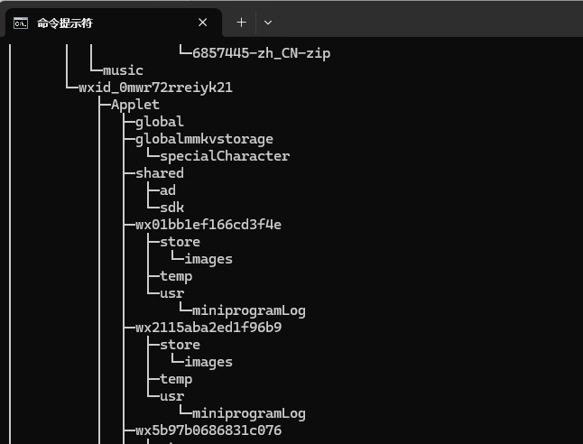

# 电气公司报价系统软件

## 1. 软件功能

做一款本地PC Windows端使用的，具备**零部件报价查询**、**历史价格录入**、**报价数据导出**等功能的软件。

定义

**元件**：不可再细分的零件；例如：接线端子、保险丝、电阻、控制器、显示屏等；

​		属性：零件编号、零件价格（价格由人工录入）；

**部件**：包含多个元件或部件；例如：线束、接触器；

​		属性：部件编号、子部件、子元件、部件没有原始价格属性，仅有所含有的部件、元件价格加和

**产品**：由多个部件组成的最终成品；例如：电气柜、臂车等；属性：

​		属性：产品编号、子部件、产品没有原始价格属性（由所有部件、元件价格加和）

### 1.1 历史价格录入

- Excel历史价格导入。支持特定Excel模板格式的历史成交价格的元件、部件、产品价格导入数据库；

  注：

  - 如果产品的价格和所含的所有零部件价格总和对不上，提示报错，录入失败，需要用户检查源数据；
  - excel模板格式待定
  - 疑问：数据库中计算的价格是否需要区分日期？例如在查询报价时按照某个时间段的日期进行计算。
  - 价格是否需要计算含税？折扣？
  - 价格是否需要区分不同供应商、以及最小起订量等

- 元件价格修改；**（部件、产品的价格不支持修改）**

- 零部件编辑。支持元件、部件、产品的新增删除；支持属性修改（如元件名称、编号等）

  - 元件、部件删除要做校验，所有包含它的部件、产品都被删除后才能删除

- 产品部件关系修改。支持部件、产品的组成部分修改；对于数据库中的某款产品，支持修改其所包含的零部件内容、数量等。

### 1.2 零部件报价查询&结果展示

- Excel报价查询。将包含各种元件、部件、产品的excel表格导入软件中，计算报价

  注：

  - 如果某些部件、元件在数据库中没有价格或没有数据、则提示用户。将有价格的数据进行计算；
  - 支持用户点击展开查看有价格、无价格的零部件，并支持选中某些数据，或无价格、有价格数据导出excel；
  - 报价查询导入的excel模板待定

- 软件在线查询。支持在线直接搜索数据库中已有的元件、部件、产品价格。搜索结果模糊匹配。

- 在线选型价格查询。下拉菜单选择零部件。例如：选择一款电控柜，以及包含的所有零部件，计算对应价格

**查询结果展示**：

结果展示的形式：分级展示。

支持层级展开、合并；

支持手动选择某些产品、零部件，单独计算所选的价格。

支持将选中的零部件产品一键导出excel表格；

-----产品1；

-----------部件1

------------------元件1

------------------元件2

展示结果包含：零部件名称；零部件价格；本地数据库中是否包含该零部件（未包含的价格按照0计算，同时该项为灰色，便于区别）

类似文件tree命令这种**层级包含关系**的格式展示

### 1.4 报价数据导出

- excel文件导出excel报价结果。支持将包含零部件的excel文件，通过软件查询到报价结果，将结果直接导出excel文件。（软件要识别系统已有价格的零部件和没有价格的零部件，方便客户对没有价格的零部件单独导出进行询价）
- 在线选型结果导出excel文件。

## 2. 软件设计

### 2.1 数据库结构设计

## 3. 需求清单

excel历史价格导入模板

模板内容：

- 物料名称（不区分大小写）
- 型号（不区分大小写）
- 成交价格（是否要区分不同时期？）如果是元件，则认为是基本价格，直接写到数据库中；如果是部件、产品，则认为是整体价格，只是作为一个参考；
- 

excel报价查询模板